# Physical PostgreSQL foreign-key ERD

Generated from actual catalog foreign keys, not conceptual table counts. Views and authorization functions are separately enumerated in physical-schema.json.

```mermaid
erDiagram
  children ||--o{ account_deletion_requests : references
  parent_principals ||--o{ account_deletion_requests : references
  admin_accounts ||--o{ admin_access_requests : references
  parent_principals ||--o{ admin_accounts : references
  admin_accounts ||--o{ admin_action_audit : references
  retention_policy_versions ||--o{ admin_action_audit : references
  admin_accounts ||--o{ admin_case_scopes : references
  admin_cases ||--o{ admin_case_scopes : references
  admin_accounts ||--o{ admin_cases : references
  children ||--o{ admin_cases : references
  admin_accounts ||--o{ admin_email_challenges : references
  admin_access_requests ||--o{ admin_notifications : references
  admin_accounts ||--o{ admin_profiles : references
  admin_accounts ||--o{ admin_role_grants : references
  admin_roles ||--o{ admin_role_grants : references
  admin_permissions ||--o{ admin_role_permissions : references
  admin_roles ||--o{ admin_role_permissions : references
  admin_accounts ||--o{ admin_sessions : references
  admin_accounts ||--o{ admin_support_read_audit : references
  retention_policy_versions ||--o{ admin_support_read_audit : references
  support_tickets ||--o{ admin_support_read_audit : references
  adult_erasure_requests ||--o{ adult_erasure_jobs : references
  retention_policy_versions ||--o{ adult_erasure_jobs : references
  parent_principals ||--o{ adult_erasure_requests : references
  notification_deliveries ||--o{ alert_delivery_attempts : references
  alert_events ||--o{ alert_delivery_outbox : references
  children ||--o{ alert_events : references
  named_places ||--o{ alert_events : references
  child_signals ||--o{ alert_events : references
  devices ||--o{ app_usage_intervals : references
  children ||--o{ app_usage_intervals : references
  devices ||--o{ audit_events : references
  parent_principals ||--o{ audit_events : references
  families ||--o{ audit_events : references
  backup_inventory ||--o{ backup_erasure_manifests : references
  account_deletion_requests ||--o{ backup_erasure_manifests : references
  retention_policy_versions ||--o{ backup_inventory : references
  devices ||--o{ capability_snapshots : references
  children ||--o{ capture_artifact_refs : references
  media_sessions ||--o{ capture_artifact_refs : references
  parent_principals ||--o{ child_access_grants_v2 : references
  child_authority_reviews ||--o{ child_access_grants_v2 : references
  children ||--o{ child_access_grants_v2 : references
  consent_records ||--o{ child_access_grants_v2 : references
  child_guardian_grants ||--o{ child_access_grants_v2 : references
  child_access_invites ||--o{ child_access_grants_v2 : references
  parent_principals ||--o{ child_access_invites : references
  children ||--o{ child_access_invites : references
  parent_principals ||--o{ child_authority_reviews : references
  children ||--o{ child_authority_reviews : references
  children ||--o{ child_guardian_grants : references
  guardian_memberships ||--o{ child_guardian_grants : references
  children ||--o{ child_media_quota_pools : references
  child_paid_entitlements ||--o{ child_media_quota_pools : references
  trial_redemptions ||--o{ child_media_quota_pools : references
  child_seat_assignments ||--o{ child_paid_entitlements : references
  children ||--o{ child_paid_entitlements : references
  children ||--o{ child_pickup_viewer_passes : references
  parent_principals ||--o{ child_pickup_viewer_passes : references
  prepaid_family_batches ||--o{ child_seat_assignments : references
  children ||--o{ child_seat_assignments : references
  devices ||--o{ child_signals : references
  children ||--o{ child_signals : references
  families ||--o{ children : references
  commands ||--o{ command_receipts : references
  commands ||--o{ command_results : references
  parent_principals ||--o{ commands : references
  devices ||--o{ commands : references
  named_places ||--o{ commute_plan_revisions : references
  commute_plans ||--o{ commute_plan_revisions : references
  commute_plan_revisions ||--o{ commute_plan_revisions : references
  parent_principals ||--o{ commute_plan_revisions : references
  commute_plan_revisions ||--o{ commute_plans : references
  named_places ||--o{ commute_plans : references
  children ||--o{ commute_plans : references
  parent_principals ||--o{ commute_plans : references
  admin_cases ||--o{ compliance_export_bundles : references
  children ||--o{ compliance_export_bundles : references
  admin_accounts ||--o{ compliance_export_bundles : references
  families ||--o{ compliance_export_bundles : references
  parent_principals ||--o{ consent_decision_audit : references
  consent_records ||--o{ consent_decision_audit : references
  consent_policy_versions ||--o{ consent_documents : references
  parent_principals ||--o{ consent_records : references
  child_authority_reviews ||--o{ consent_records : references
  children ||--o{ consent_records : references
  consent_documents ||--o{ consent_records : references
  consent_policy_versions ||--o{ consent_records : references
  devices ||--o{ credential_renewal_challenges : references
  device_key_records ||--o{ credential_renewal_challenges : references
  devices ||--o{ device_credentials : references
  device_key_records ||--o{ device_credentials : references
  devices ||--o{ device_health : references
  devices ||--o{ device_key_records : references
  location_observations ||--o{ device_latest_positions : references
  devices ||--o{ device_permission_change_events : references
  permission_snapshots ||--o{ device_permission_change_events : references
  devices ||--o{ device_reenrollment_events : references
  parent_principals ||--o{ device_reenrollment_events : references
  children ||--o{ devices : references
  devices ||--o{ enrollment_challenges : references
  families ||--o{ entitlement_audit : references
  play_purchase_records ||--o{ entitlement_audit : references
  erasure_jobs ||--o{ erasure_evidence : references
  retention_policy_versions ||--o{ erasure_evidence : references
  erasure_jobs ||--o{ erasure_job_targets : references
  account_deletion_requests ||--o{ erasure_jobs : references
  children ||--o{ export_jobs : references
  retention_policy_versions ||--o{ export_jobs : references
  parent_principals ||--o{ export_jobs : references
  children ||--o{ extra_viewer_purchases : references
  play_purchase_records ||--o{ extra_viewer_purchases : references
  families ||--o{ family_checkout_intents : references
  parent_principals ||--o{ family_checkout_intents : references
  billing_product_catalog ||--o{ family_checkout_intents : references
  faq_revisions ||--o{ faq_entries : references
  admin_accounts ||--o{ faq_revisions : references
  faq_entries ||--o{ faq_revisions : references
  families ||--o{ founding_families : references
  families ||--o{ guardian_memberships : references
  parent_principals ||--o{ guardian_memberships : references
  parent_principals ||--o{ idempotency_claims : references
  location_ingest_batches ||--o{ ingestion_outbox : references
  usage_categories ||--o{ installed_app_inventory : references
  devices ||--o{ installed_app_inventory : references
  location_ingest_batches ||--o{ location_batch_items : references
  location_event_dedup ||--o{ location_batch_items : references
  children ||--o{ location_collection_policies : references
  devices ||--o{ location_event_dedup : references
  children ||--o{ location_event_dedup : references
  devices ||--o{ location_ingest_batches : references
  children ||--o{ location_ingest_batches : references
  location_event_dedup ||--o{ location_observations : references
  parent_principals ||--o{ media_access_audit : references
  children ||--o{ media_access_audit : references
  parent_principals ||--o{ media_command_requests : references
  children ||--o{ media_command_requests : references
  devices ||--o{ media_command_requests : references
  media_capability_gates ||--o{ media_command_requests : references
  parent_principals ||--o{ media_export_requests : references
  children ||--o{ media_export_requests : references
  media_sessions ||--o{ media_lifecycle_events : references
  extra_viewer_purchases ||--o{ media_quota_ledger : references
  children ||--o{ media_quota_ledger : references
  media_capability_gates ||--o{ media_quota_ledger : references
  media_sessions ||--o{ media_quota_ledger : references
  child_media_quota_pools ||--o{ media_quota_ledger : references
  media_command_requests ||--o{ media_request_device_approvals : references
  devices ||--o{ media_request_device_approvals : references
  parent_principals ||--o{ media_sessions : references
  children ||--o{ media_sessions : references
  media_command_requests ||--o{ media_sessions : references
  children ||--o{ named_places : references
  parent_principals ||--o{ named_places : references
  alert_events ||--o{ notification_deliveries : references
  parent_principals ||--o{ notification_deliveries : references
  parent_principals ||--o{ notification_preferences : references
  children ||--o{ notification_preferences : references
  children ||--o{ pairing_codes : references
  guardian_memberships ||--o{ pairing_codes : references
  parent_principals ||--o{ parent_notification_read_receipts : references
  notification_deliveries ||--o{ parent_notification_read_receipts : references
  parent_principals ||--o{ parent_service_usage_events : references
  retention_policy_versions ||--o{ parent_service_usage_events : references
  play_purchase_records ||--o{ payment_reconciliation_inbox : references
  devices ||--o{ permission_snapshots : references
  parent_principals ||--o{ place_notification_rules : references
  named_places ||--o{ place_notification_rules : references
  family_checkout_intents ||--o{ play_purchase_records : references
  families ||--o{ play_purchase_records : references
  parent_principals ||--o{ play_purchase_records : references
  billing_product_catalog ||--o{ play_purchase_records : references
  rule_assignments ||--o{ policy_execution_receipts : references
  parent_principals ||--o{ premium_viewer_leases : references
  children ||--o{ premium_viewer_leases : references
  trusted_sessions ||--o{ premium_viewer_leases : references
  families ||--o{ prepaid_family_batches : references
  play_purchase_records ||--o{ prepaid_family_batches : references
  billing_product_catalog ||--o{ price_offers : references
  payment_reconciliation_inbox ||--o{ purchase_adjustments : references
  play_purchase_records ||--o{ purchase_adjustments : references
  restore_runs ||--o{ restore_ledger_imports : references
  backup_inventory ||--o{ restore_runs : references
  child_erasure_tombstones ||--o{ restore_suppression_receipts : references
  restore_runs ||--o{ restore_suppression_receipts : references
  families ||--o{ revocation_epochs : references
  devices ||--o{ rule_assignments : references
  screen_time_rules ||--o{ rule_assignments : references
  parent_principals ||--o{ scheduled_child_tasks : references
  devices ||--o{ scheduled_child_tasks : references
  children ||--o{ scheduled_child_tasks : references
  children ||--o{ screen_time_rules : references
  parent_principals ||--o{ screen_time_rules : references
  parent_principals ||--o{ security_audit_events : references
  parent_principals ||--o{ signal_acknowledgements : references
  child_signals ||--o{ signal_acknowledgements : references
  trip_routepoints ||--o{ stops : references
  named_places ||--o{ stops : references
  trip_revisions ||--o{ stops : references
  admin_accounts ||--o{ support_messages : references
  parent_principals ||--o{ support_messages : references
  support_tickets ||--o{ support_messages : references
  admin_accounts ||--o{ support_tickets : references
  parent_principals ||--o{ support_tickets : references
  devices ||--o{ tracking_policy_revisions : references
  children ||--o{ trial_child_entitlements : references
  trial_redemptions ||--o{ trial_child_entitlements : references
  families ||--o{ trial_eligibility_checks : references
  parent_principals ||--o{ trial_eligibility_checks : references
  trial_redemptions ||--o{ trial_eligibility_checks : references
  families ||--o{ trial_redemptions : references
  parent_principals ||--o{ trial_redemptions : references
  trip_routepoints ||--o{ trip_legs : references
  trip_revisions ||--o{ trip_legs : references
  trips ||--o{ trip_revisions : references
  location_observations ||--o{ trip_routepoints : references
  trips ||--o{ trip_routepoints : references
  trip_revisions ||--o{ trip_routepoints : references
  devices ||--o{ trips : references
  children ||--o{ trips : references
  trip_revisions ||--o{ trips : references
  parent_principals ||--o{ trusted_principal_verifications : references
  device_key_records ||--o{ trusted_sessions : references
  devices ||--o{ trusted_sessions : references
  families ||--o{ trusted_sessions : references
  parent_principals ||--o{ trusted_sessions : references
  premium_viewer_leases ||--o{ viewer_takeover_requests : references
  children ||--o{ viewer_takeover_requests : references
  parent_principals ||--o{ viewer_takeover_requests : references
```

